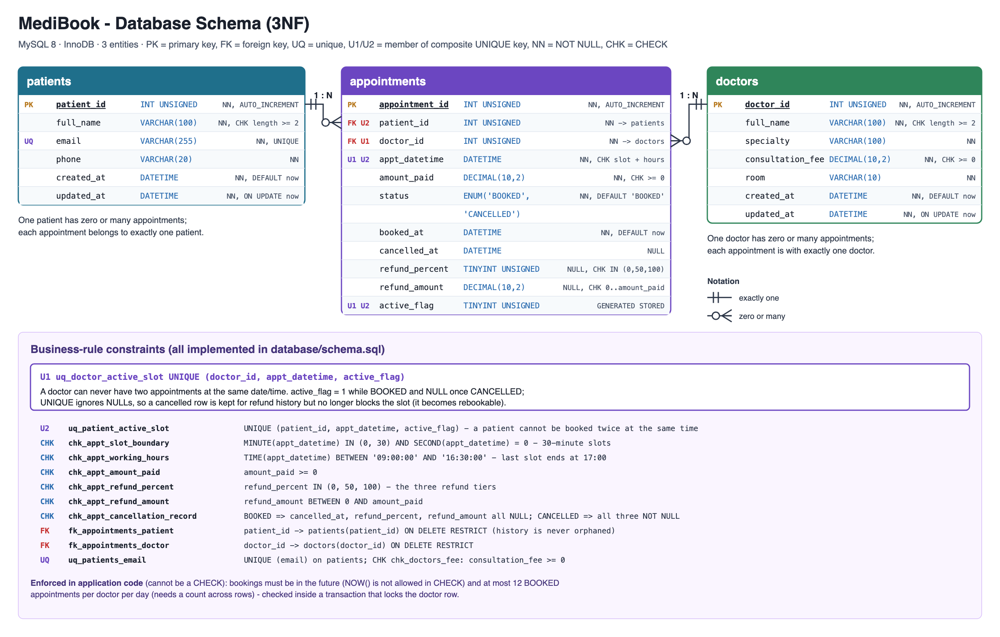

# MediBook — Clinic Appointment System (Backend)

[](https://github.com/armeleger/adv-backend-summative-medibook-project/actions/workflows/test.yml)

Express.js + MySQL + Redis backend for booking doctor appointments: patients, doctors and appointments; booking rules (future only, working hours, 30-minute slots, 12 appointments per doctor per day, no double booking under concurrency); cancellations with server-computed refunds; a Redis-backed waitlist promoted by a separate worker process; an audit log; SQL reports; and a localized feedback page.

**Video walkthrough:** [https://youtu.be/UJ9EUYq18hk](https://youtu.be/UJ9EUYq18hk)

The original assignment brief is in [docs/assignment-brief.md](docs/assignment-brief.md).

---

## Contents

1. [Setup](#setup)
2. [Project structure](#project-structure)
3. [Database design](#database-design-part-a--b)
4. [API reference](#api-reference-part-c)
5. [Design decisions and justifications](#design-decisions-and-justifications)
6. [Testing](#testing-part-f)
7. [Demo walkthrough](#demo-walkthrough)

---

## Setup

### Prerequisites

- Node.js 20+
- MySQL 8.0.16+ (CHECK constraints must be enforced)
- Redis 6.2+ (the worker uses `BLMOVE`)

On macOS with Homebrew:

```bash
brew install mysql redis
```

```bash
brew services start mysql
```

```bash
brew services start redis
```

### Install and configure

```bash
npm install
```

```bash
cp .env.example .env
```

Edit `.env` with your MySQL credentials. All variables:

| Variable | Default | Purpose |
|---|---|---|
| `PORT` | `3000` | HTTP port |
| `DB_HOST` / `DB_PORT` | `127.0.0.1` / `3306` | MySQL server |
| `DB_USER` / `DB_PASSWORD` | `root` / *(empty)* | MySQL credentials |
| `DB_NAME` | `medibook` | Database name (created by `schema.sql`) |
| `REDIS_URL` | `redis://127.0.0.1:6379` | Redis server |
| `TZ` | system timezone | Clinic timezone, e.g. `Africa/Kigali` (see [Time handling](#time-handling)) |
| `AUDIT_LOG_FILE` | `logs/audit.log` | Audit log location |

### Create the database

Either with the MySQL client:

```bash
mysql -u root -p < database/schema.sql && mysql -u root -p < database/seed.sql
```

or with the bundled script, which reads `.env`:

```bash
npm run db:setup
```

`schema.sql` drops and recreates the `medibook` database, so it can be re-run at any time to reset the data. Seed dates are relative to the day you run it, so the "upcoming" appointments are always in the future.

### Run

The API and the worker are **two separate processes**. Start each one in its own terminal:

```bash
npm start
```

```bash
npm run worker
```

- API: `http://localhost:3000` (health check: `GET /health`)
- Feedback page: `http://localhost:3000/feedback` and `http://localhost:3000/feedback?lang=fr`

### Tests

```bash
npm test
```

The tests need no MySQL or Redis server.

---

## Project structure

```
├── database/
│   ├── schema.sql            DDL: 3 tables, keys, constraints (Part B.1)
│   └── seed.sql              sample data incl. zero-appointment doctor + near-cap day
├── locales/                  en.json, fr.json for the feedback page (Part G)
├── schema-diagram.svg/.png   database diagram (Part A)
├── requests.http             ready-made requests for every endpoint (VS Code REST Client)
├── scripts/db-setup.js       runs schema.sql + seed.sql
├── src/
│   ├── server.js             web server entry point (npm start)
│   ├── worker.js             background worker entry point (npm run worker)
│   ├── app.js                Express app: middleware + routes
│   ├── config/
│   │   ├── env.js            all configuration from environment variables
│   │   └── businessRules.js  12/day cap, hours, slot size, refund tiers, busy threshold
│   ├── models/               ALL SQL lives here (parameterized, mysql2)
│   ├── services/             booking, cancellation, waitlist, notification workflows
│   ├── controllers/          request validation -> services/models -> response
│   ├── routes/               URL + HTTP method -> controller
│   ├── middleware/           central error handler, 404 handler
│   ├── queues/               Redis client, job queue, waitlist store
│   ├── utils/                pure functions: slot validator, refund calculator, validators, audit logger, i18n
│   └── views/                feedback page HTML
└── tests/                    Jest unit tests
```

**Layering rules**

- SQL appears only in `src/models/`. Every value is passed as a `?` placeholder through `mysql2` (`execute` prepared statements). The only SQL built dynamically is the `SET` list of an `UPDATE` and the `WHERE` filters of the appointment list. Their column names and fragments come from fixed whitelists in the model, never from the request.
- Controllers never touch the database directly. They call models, or services for multi-step workflows.
- Business values (the 12-per-day cap, working hours, slot length, refund tiers, the 80% threshold) are defined once, in `src/config/businessRules.js`. `schema.sql` repeats the slot rules as CHECK constraints so the database also protects itself.

---

## Database design (Part A & B)



### Normalization

The spreadsheet mixes three things in every row: who the patient is, who the doctor is, and the booking itself.

- **1NF**: every column is atomic. The `appt_datetime` text becomes one `DATETIME`, and `doctor_name` (which carried a "Dr." title) and the patient columns are single values.
- **2NF / 3NF**: `patient_email` and `patient_phone` depend on the patient, not on the booking. `specialty`, `consultation_fee` and `room` depend on the doctor, not the booking. Keeping them on each appointment row is a transitive dependency (`appt_ref → doctor → room`), and it causes update anomalies: change Dr. Boateng's room and you must edit every one of their rows. They move to `patients` and `doctors`. `appointments` keeps only the two foreign keys plus the facts about the booking itself.
- `amount_paid` **stays** on `appointments`. It is what was actually charged for that booking (AP-002 paid 120.00 against a 150.00 fee), and fees change over time, so it cannot be derived from `doctors.consultation_fee`.
- `appt_ref` (AP-001) is replaced by the surrogate key `appointment_id`. The `AP-xxx` form is generated from it for messages.

### Relationships

- `patients 1 — 0..N appointments`. Each appointment has exactly one patient.
- `doctors 1 — 0..N appointments`. Each appointment has exactly one doctor.

Both foreign keys use `ON DELETE RESTRICT`. A patient or doctor with appointment history cannot be deleted, so refund records are never orphaned. The API returns `409` in this case.

### Key constraints

| Constraint | Rule |
|---|---|
| `uq_doctor_active_slot UNIQUE (doctor_id, appt_datetime, active_flag)` | **A doctor cannot hold two appointments at the same date/time.** |
| `uq_patient_active_slot UNIQUE (patient_id, appt_datetime, active_flag)` | A patient cannot be booked twice at the same time. |
| `chk_appt_slot_boundary` | `MINUTE IN (0,30)` and `SECOND = 0` |
| `chk_appt_working_hours` | `TIME BETWEEN '09:00:00' AND '16:30:00'` |
| `chk_appt_refund_percent` / `chk_appt_refund_amount` | refund ∈ {0, 50, 100}%, and 0 ≤ refund ≤ amount paid |
| `chk_appt_cancellation_record` | BOOKED rows have no cancellation data; CANCELLED rows must have `cancelled_at`, `refund_percent` and `refund_amount` |
| `uq_patients_email` | one patient per email |

**Why `active_flag`?** A plain `UNIQUE (doctor_id, appt_datetime)` would keep blocking a slot forever after it is cancelled, because the cancelled row has to stay for refund history. `active_flag` is a stored generated column: `1` while `status = 'BOOKED'`, `NULL` once cancelled. MySQL unique indexes allow any number of NULLs, so the uniqueness rule applies only to active bookings. A cancelled slot is immediately rebookable and the old row is kept.

Two rules cannot be CHECK constraints. "In the future" needs `NOW()`, which CHECK does not allow. "At most 12 per day" needs a count across rows. Both are enforced in the booking transaction (below).

**Types**: money is `DECIMAL(10,2)` (exact, unlike `FLOAT`), slots are `DATETIME`, and status is an `ENUM`.

---

## API reference (Part C)

Base URL `http://localhost:3000`. Request and response bodies are JSON. Successful responses wrap the payload in `{ "data": ... }`; errors are always `{ "error": { "message", "code", "details?" } }`.

### Patients

| Method | Path | Description | Success |
|---|---|---|---|
| GET | `/api/patients` | List patients | 200 |
| GET | `/api/patients/:id` | Get one patient | 200 / 404 |
| POST | `/api/patients` | Create `{ fullName, email, phone }` | 201 + `Location` |
| PUT | `/api/patients/:id` | Replace (all fields required) | 200 |
| PATCH | `/api/patients/:id` | Update some fields | 200 |
| DELETE | `/api/patients/:id` | Delete (409 if they have appointments) | 204 |
| GET | `/api/patients/:id/appointments` | The patient's appointments | 200 |

### Doctors

| Method | Path | Description | Success |
|---|---|---|---|
| GET | `/api/doctors` | List doctors | 200 |
| GET | `/api/doctors/:id` | Get one doctor | 200 / 404 |
| POST | `/api/doctors` | Create `{ fullName, specialty, consultationFee, room }` | 201 |
| PUT / PATCH | `/api/doctors/:id` | Replace / partially update | 200 |
| DELETE | `/api/doctors/:id` | Delete (409 if they have appointments) | 204 |
| GET | `/api/doctors/:id/stats` | **Statistics** (C.4) | 200 |
| GET | `/api/doctors/:id/availability?date=YYYY-MM-DD` | Free/booked slots for a day | 200 |
| GET | `/api/doctors/:id/appointments?date=` | The doctor's appointments | 200 |

### Appointments

| Method | Path | Description | Success |
|---|---|---|---|
| POST | `/api/appointments` | **Book** `{ patientId, doctorId, appointmentDatetime: "2026-12-01T10:30" }` | 201 |
| GET | `/api/appointments?patientId=&doctorId=&date=&status=` | List with filters | 200 |
| GET | `/api/appointments/:id` | Get one | 200 / 404 |
| DELETE | `/api/appointments/:id` | **Cancel**: returns the refund; the record is kept with status `CANCELLED` | 200 |

### Waitlist

| Method | Path | Description | Success |
|---|---|---|---|
| POST | `/api/waitlist` | Join `{ patientId, doctorId, appointmentDatetime }` when that slot/day is full | 201 |
| GET | `/api/waitlist?doctorId=&date=` | View a doctor-day's queue in order | 200 |
| DELETE | `/api/waitlist/:doctorId/:date/:patientId` | Leave a waitlist | 204 |

### Reports

| Method | Path | Description |
|---|---|---|
| GET | `/api/reports/doctors` | Every doctor's total appointments and revenue, including doctors with none (C.5) |
| GET | `/api/reports/busy-days` | Every (doctor, date) with more than 80% of the 12 slots booked (C.6) |

### Feedback page (Part G)

`GET /feedback` (English) and `GET /feedback?lang=fr` (French). Unsupported values fall back to English. `POST /feedback` validates that all five answers are present.

### Status codes

| Code | When |
|---|---|
| 400 | Malformed input: bad JSON, missing/unknown fields, non-numeric id, unreadable date |
| 404 | Unknown patient/doctor/appointment id or route |
| 409 | Conflicts with current state: slot taken, day full (both include a waitlist offer), patient double-booked, already cancelled, duplicate email, deleting a record with history |
| 422 | Well-formed but breaks a rule: slot in the past, outside 09:00–17:00, not on a :00/:30 boundary, cancelling a past appointment, joining a waitlist for a slot that is still free |
| 503 | Redis/MySQL temporarily unavailable |

**Leaving a waitlist** uses `DELETE /api/waitlist/:doctorId/:date/:patientId`. A waitlist entry is identified by its natural key, (doctor, day, patient), because a patient can be on a given doctor-day waitlist only once. That is the same key Redis uses, so the client never needs to know an internal entry id. If the worker has already read the list when a patient leaves, it re-checks membership before booking them.

**REST choices.** Cancellation is `DELETE /api/appointments/:id`. From the client's point of view the booking is removed. The server performs a soft delete (status `CANCELLED`) to keep refund history, so the response is `200` with the refund details rather than `204`. Statistics and availability are sub-resources of a doctor (`/doctors/:id/stats`). Cross-doctor reports live under `/reports`.

---

## Design decisions and justifications

### Booking rules and concurrency (C.2)

All booking rules live in `src/services/bookingService.js`. The API and the worker both use it, so no path can skip a rule.

1. **Slot rules** come from the pure function `validateSlot()`: future only, start between 09:00 and 16:30 so the appointment ends by 17:00, minute 00 or 30, seconds 0. 17:00 itself is rejected.
2. **Transaction with a doctor row lock.** The first statement is `SELECT … FROM doctors WHERE doctor_id = ? FOR UPDATE`. Every booking for the same doctor must take that lock, so concurrent bookings for one doctor run **one after another**. Inside the lock the service checks the slot is free, counts the doctor's BOOKED appointments that day (`< 12`), checks the patient is free, then inserts. Without the lock, two requests could both count 11 and both insert, making 13. Bookings for different doctors lock different rows and still run in parallel.
3. **READ COMMITTED isolation.** Under MySQL's default REPEATABLE READ, a plain `SELECT COUNT(*)` could read a snapshot taken before the previous booking committed. READ COMMITTED makes every statement see the latest committed rows once the lock is held.
4. **Unique indexes as the final guard.** If anything slipped through (or someone inserted rows by hand), `uq_doctor_active_slot` makes the second insert fail with `ER_DUP_ENTRY`, which is returned as `409 SLOT_TAKEN`.
5. **The fee is set server-side** (`amount_paid = doctors.consultation_fee`). The client never sends a price.

Verified: 10 simultaneous requests for the same slot gave exactly one `201` and nine `409`s; 16 simultaneous bookings for different slots of one doctor-day gave exactly 12 `201`s.

### Cancellation and refunds (C.3)

- **Policy** (from `businessRules.js`): notice **> 48h → 100%**; **24h ≤ notice ≤ 48h → 50%**; **< 24h → 0%**. Both boundaries belong to the middle tier: exactly 48h is not "more than 48 hours", and exactly 24h is inside "24–48 hours". The unit tests cover both boundaries and one second either side.
- The refund is computed on the server by the pure `calculateRefund()`, from the stored `amount_paid` and the time of the request. The maths is done in whole cents to avoid floating-point errors. The response states the notice in hours, the percentage and the amount.
- **Atomicity.** With only three tables allowed, the refund record lives on the appointment row (`cancelled_at`, `refund_percent`, `refund_amount`). Status and refund are written by **one** `UPDATE` inside a transaction that first locks the row (`SELECT … FOR UPDATE`), so they succeed or fail together. A second concurrent cancel waits, then sees `CANCELLED` and gets `409`. `chk_appt_cancellation_record` makes a CANCELLED row without refund data impossible at the database level.
- **Rebookable slot, kept record.** The row stays, so `active_flag` becomes NULL and the slot is free again (see `active_flag` above).
- Past or started appointments cannot be cancelled (`422`).
- After commit, a `SLOT_FREED` job is queued so the worker can offer the slot to the waitlist.

### Statistics and reports (C.4–C.6)

All numbers are computed in SQL (`src/models/reportModel.js`). The controllers only pass in parameters such as the cap and the date window.

- **Revenue collected** = `SUM(amount_paid − COALESCE(refund_amount, 0))`: money paid minus money refunded. A 50% cancellation keeps half the fee; a 100% one contributes nothing.
- **Upcoming** = BOOKED appointments after now.
- **Per day for 7 days** (today + 6): a recursive CTE generates the 7 dates and `LEFT JOIN`s appointments, so days with zero bookings still appear. Utilization per day = `COUNT × 100 / 12`. Overall utilization = booked in window `× 100 / (12 × 7)`.
- **Doctors report**: `doctors LEFT JOIN appointments … GROUP BY doctor`, with `COALESCE` so doctors with no appointments show `0`s (seeded Dr. Esi Quaye).
- **Busy days**: `GROUP BY doctor, date HAVING COUNT(*) > 0.8 × 12`, i.e. more than 9.6, so 10 or more BOOKED appointments. Cancelled appointments do not count.

### Audit log (Part D)

`src/utils/auditLogger.js` appends one JSON object per line to `logs/audit.log`:

```json
{"timestamp":"2026-11-17T12:18:28.582Z","event":"APPOINTMENT_CANCELLED","appointmentId":11,"refundPercent":100,"refundAmount":150,...}
```

- Only async `fs/promises` (`mkdir`, `appendFile`) is used. There are no `*Sync` calls anywhere in request handling.
- `logs/` is created with `mkdir({ recursive: true })` at server/worker start-up and again lazily before the first write. The promise is cached so this happens once per process.
- `log()` catches its own errors and resolves `false`. A full disk or a permissions problem prints a console error but **never** fails the booking or cancellation, which has already been committed.
- Events: `APPOINTMENT_BOOKED`, `APPOINTMENT_CANCELLED`, `CONFIRMATION_SENT`, `WAITLIST_JOINED`, `WAITLIST_PROMOTED`, `WAITLIST_SKIPPED`, `WAITLIST_REMOVED`, `WAITLIST_NOT_PROMOTED`, `JOB_ENQUEUE_FAILED`, `JOB_FAILED`. Both the API and the worker write to it. Each line is a single small `O_APPEND` write, so lines from the two processes do not interleave.

### Queues, waitlist and worker (Part E)

Plain Redis lists via `ioredis`, so every step is visible and explainable.

**Waitlist.** When a booking fails with `SLOT_TAKEN` or `DAY_FULL`, the `409` response includes a waitlist offer. `POST /api/waitlist` puts the patient in a FIFO list per doctor per day (`medibook:waitlist:<doctorId>:<date>`). A companion SET stops duplicates. Both are updated by one Lua script, so the list and the set never disagree. Joining is refused if the slot is actually free (`422`) or the patient already has an appointment with that doctor that day (`409`). The keys expire after the day has passed. A waitlisted patient accepts **any** slot that frees up with that doctor on that day.

**Jobs.** After commit, the API pushes jobs onto `medibook:jobs`:

- `SEND_CONFIRMATION` for every confirmed appointment, both direct and promoted. The worker writes the SMS/email text it would send to the audit log.
- `SLOT_FREED` for every cancellation.

**Worker** (`src/worker.js`, a separate `npm run worker` process):

- `BLMOVE medibook:jobs → medibook:jobs:processing` takes a job atomically. The job is removed from `processing` only after it succeeds.
- On failure the job waits in the sorted set `medibook:jobs:delayed`, scored by its retry time, with exponential backoff: 5s, 10s, 20s, 40s, then 60s, about 2 minutes in total. That is enough to ride out a database or Redis restart. Each move is a single `MULTI` or Lua script, so a job is never in neither place. After 6 attempts it moves to `medibook:jobs:failed` and is logged.
- Malformed jobs (invalid JSON) and unknown job types can never succeed, so they go straight to `medibook:jobs:failed`.
- On start-up, anything left in `processing` (worker crashed mid-job) is moved back to the queue.

**What if the promoted booking fails?** The patient must not vanish from both the queue and the table:

- Waitlist entries are only **read** while promotion is attempted. An entry is removed from Redis **only after** the appointment row is committed.
- If the booking fails for a reason specific to this patient (they already have another appointment at that time), they **keep their place** and the slot is offered to the next patient in line.
- If the slot is no longer available to anyone (booked directly in the meantime, now in the past, doctor gone), nobody is promoted and everyone keeps their place.
- If the error is unexpected (database down, deadlock), the entry is untouched and the job is retried.
- If the worker crashes between the commit and the removal, the patient is briefly in **both** places. The next run sees they are already booked and removes the stale entry. "In both" is recoverable; "in neither" cannot happen.
- A patient deleted while waiting is removed and the removal is logged.

**Redis down?** Bookings and cancellations still succeed. They are committed to MySQL first, and a failed enqueue is logged as `JOB_ENQUEUE_FAILED` instead of failing the request. Waitlist endpoints, which need Redis, return `503`.

### Time handling

MySQL `DATETIME` has no timezone. Appointment times are stored as clinic wall-clock time, and the API and worker run with `TZ` set to the clinic's timezone. `mysql2` is configured with `dateStrings: true`, so DATETIMEs come back as `"YYYY-MM-DD HH:mm:ss"` strings and are never shifted by a timezone conversion. "Now" is always taken from Node and passed into SQL as a parameter, so the database server's timezone does not matter.

---

## Testing (Part F)

```bash
npm test
```

GitHub Actions (`.github/workflows/test.yml`) runs the same `npm test` on Node 20 and 22 for every push to `main` and every pull request.

None of the tests need MySQL or Redis. The unit tests use pure functions with fixed dates, so results never depend on when they run. The API tests mock the models and services.

| File | What it covers |
|---|---|
| `tests/refundCalculator.test.js` | 100% / 50% / 0% tiers; **exactly 48h → 50%**, **exactly 24h → 50%**, plus one second either side; cent rounding; invalid input |
| `tests/slotValidator.test.js` | valid slots; 09:00 and 16:30 allowed; **17:00 rejected**; 08:30; **09:15**; non-zero seconds; past and "now"; **malformed dates** (2026-02-30, 25:00, wrong format, non-string) → 400 |
| `tests/validators.test.js` | patient/doctor/booking payload validation, partial updates, id parsing |
| `tests/auditLogger.test.js` | creates nested `logs/` dir, writes JSON lines, a write failure resolves `false` instead of throwing |
| `tests/jobQueue.test.js` | job validation (malformed JSON, missing type/payload) and the retry backoff schedule |
| `tests/api.test.js` | HTTP-level tests with `supertest` against the real app (routes, validation, central error handler) with models and services mocked: 400/404/409/422/500 responses, `Location` headers, the waitlist offer, the refund message, leaving a waitlist, the feedback page |
| `tests/i18n.test.js` | locale resolution and fallback (`de`, `__proto__`, array values), 5 questions per locale, locale date formatting, HTML escaping |

---

## Demo walkthrough

`requests.http` contains every request below. Open it in VS Code with the REST Client extension, which computes the dates relative to today, or use Postman with the same requests.

1. `GET /api/reports/busy-days`: Dr. Boateng (doctor 1) has 11 bookings three days from now (91.7%).
2. `POST /api/appointments` for doctor 1 at 16:30 that day → `201`. That is the 12th booking, and the worker logs a confirmation.
3. Book doctor 1 again that day → `409 DAY_FULL` with a waitlist offer.
4. `POST /api/waitlist` with the same body → `201`, position 1.
5. `DELETE /api/appointments/:id` for one of doctor 1's appointments that day → `200`, 100% refund (> 48h notice).
6. The worker terminal prints `promoted patient … → appointment …`. `GET /api/waitlist?...` is now empty and `GET /api/doctors/1/appointments?date=...` shows the new booking.
7. `tail logs/audit.log` shows the BOOKED, CANCELLED, WAITLIST_PROMOTED and CONFIRMATION_SENT lines.
8. `GET /api/doctors/1/stats`, `GET /api/reports/doctors` (doctor 4 with zeros) and `GET /api/reports/busy-days`.
9. Open `/feedback` and `/feedback?lang=fr`.
